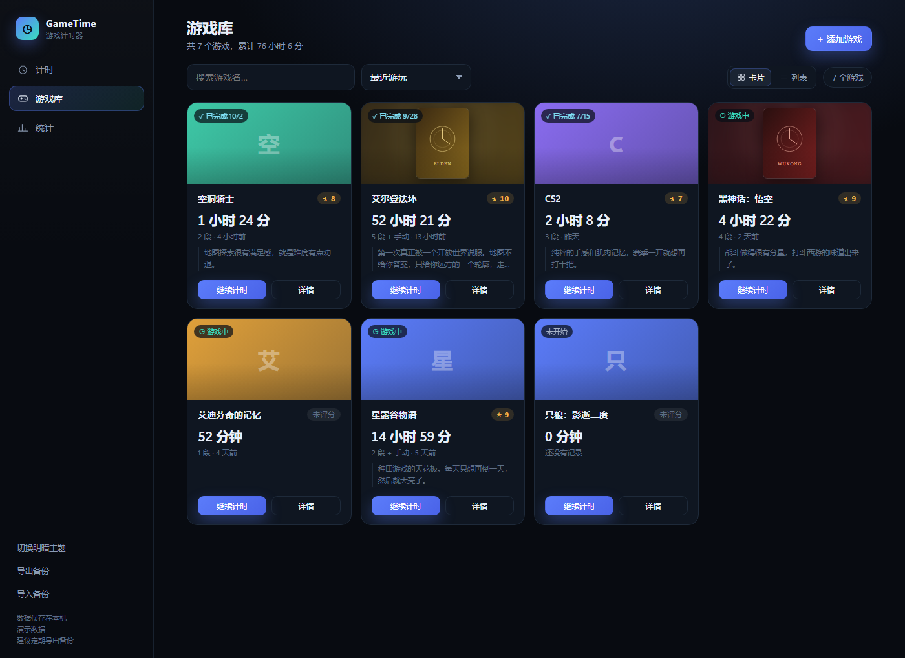
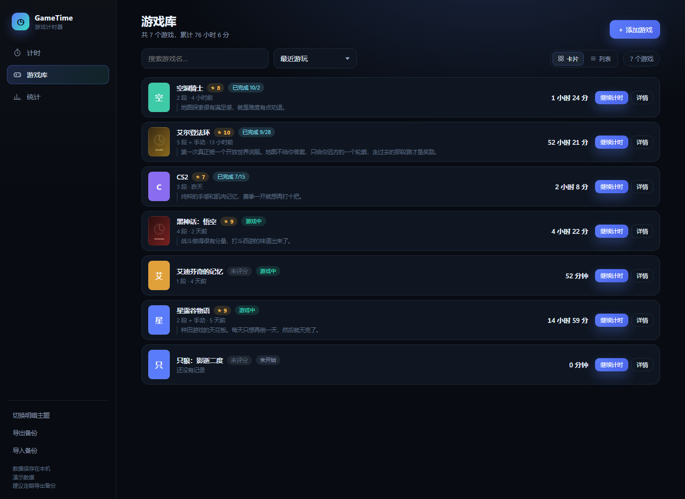
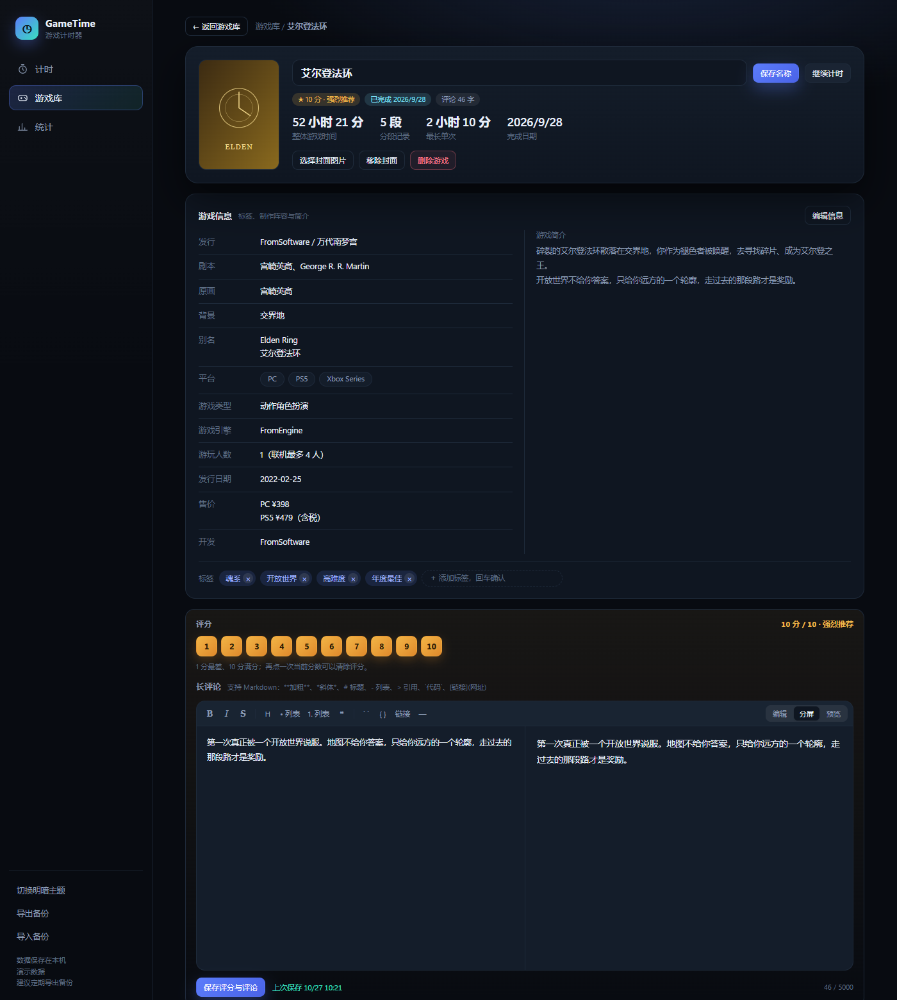
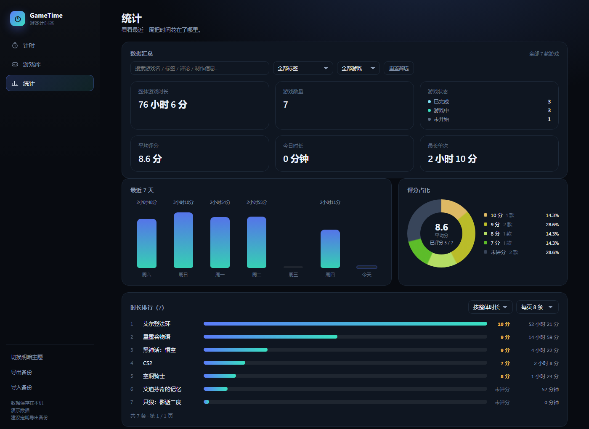

# gal_time · GameTime 游戏计时器

一个跑在本机的 Galgame 计时器。纯本地、单文件、不联网，代码全部由 AI 编写。

用来记录每款游戏玩了多少小时、什么时候通关、打几分，以及写一篇很长的玩后感。



---

## 功能

### 计时

- 选一款游戏点开始，可暂停、可继续；同一款游戏下次再玩，时长自动累加，不会覆盖上次的记录
- 每次游玩都会存成一段独立记录，带开始与结束时间
- 计时页显示「今天」累计时长和「这款游戏最近」的记录
- 计时中关闭窗口，进行中的那段会在退出前自动结算并保存
- 非输入状态下按 **空格** 即可开始 / 暂停

### 游戏库

- **两种视图**：卡片（带封面）和紧凑列表，随时切换，选择会被记住
- **搜索**：游戏名、评论正文、**标签**、以及作品信息（发行 / 剧本 / 开发 / 平台 / 类型 / 简介）都能搜到
- **排序**：最近游玩 / 整体时长 / 评分 / 完成日期 / 名称
- **封面**：可选本机图片，自动压缩后存本地；没有封面时用游戏名首字生成彩色底图
- **标签**：卡片上显示前 3 个，多的折成 `+N`
- **状态自动判定**，不需要手动维护：

  | 状态 | 判定条件 |
  | --- | --- |
  | ✓ 已完成 | 填过完成日期 |
  | ◷ 游戏中 | 还没通关，但已经有计时或补录记录 |
  | 未开始 | 一分钟都还没记过 |

### 游戏详情

点游戏库里的任意一款进入整页详情（不是弹窗），可以做这些事：

- 改名、更换或移除封面、删除游戏
- **整体游戏时间**：直接把 Steam 上看到的总时长填进去，程序会把超出分段合计的部分记成一条「手动记录」，已有分段一条都不会被改动、合并或删除
- **完成日期**：填了就算已完成，也可以清除
- **游戏信息**（顶部信息块下面一整张卡）：

  | 字段 | 说明 |
  | --- | --- |
  | 发行 / 开发 / 剧本 / 原画 / 背景 | 单行文本 |
  | 别名 | 多行，中译名 / 原名可以各占一行 |
  | 平台 | 逗号或顿号分隔，保存后拆成圆角小标签 |
  | 游戏类型 / 游戏引擎 / 游玩人数 / 发行日期 | 单行文本 |
  | 售价 | 多行，不同平台不同价可以一行一个 |
  | 游戏简介 | 多行文本，最多 3000 字 |

  没填的项显示 `—`。点「编辑信息」进表单，保存或取消。
- **标签**：不用进编辑态，在卡底的输入框打字回车即可添加，点标签上的 `×` 删除；最多 30 个、每个 20 字，自动去重
- **评分**：1–10 分，点一次选中，再点一次当前分数即清除
- **Markdown 长评论**：上限 5000 字
  - 工具栏支持加粗、斜体、删除线、标题、列表、引用、行内代码、代码块、链接、分隔线
  - 编辑 / 分屏 / 预览三种视图，默认左写右看
  - 停止输入约 1 秒自动保存，返回或关窗口前会再补存一次

### 统计

- 顶部是一张**数据汇总卡**，筛选控件就在卡里：搜索框、标签下拉、状态下拉、重置按钮
- **KPI 随筛选联动**：整体游戏时长、游戏数量、三种状态分布、平均评分、今日时长、最长单次，全部只统计筛选结果；右上角标注「全部 7 款游戏」或「筛选出 3 款 / 共 7 款」
- **最近 7 天**柱状图与**评分占比**环状图同样跟随筛选（环状图中心显示平均分和「已评分 x / y」）
- **不参与联动的是分页**：换页、改每页条数只影响列表显示几行，汇总数字按「筛选后的全部游戏」计算，不按当前页计算
- **游戏排行**：可按整体时长 / 分数 / 完成日期 / 名称排序，支持每页 5/8/10/20/50 条或全部显示

### 数据

- 全部存在本机，不联网、不上传、无账号
- 侧栏可一键**导出备份**（JSON）和**导入备份**
- 写入失败时会弹出常驻提示条并提供「重试保存 / 导出备份」，不会静默丢数据
- 数据格式 version 3，兼容历史存档

---

## 使用方式

### 环境要求

- Windows 10 / 11
- Microsoft Edge（系统自带，无需另装）

### 启动

双击 `GameTime\GameTime.exe`（推荐），或 `GameTime\启动游戏计时器.vbs`：

```
GameTime\GameTime.exe
```

会打开一个**没有地址栏和标签页**的独立窗口（1300×900），看起来就像原生小应用。
如果 exe 被安全软件拦截，改用 `启动游戏计时器.vbs` 或 `启动游戏计时器（备用）.bat`。

> **首次运行可能弹出「打开文件 - 安全警告：无法验证发布者」**。这是 Windows 对未签名可执行文件的常规提示，与程序安全性无关：项目没有购买代码签名证书，文件也是本地构建、不带「来自其他计算机」标记。点「运行(R)」即可；想完全不看到它就用 `.vbs` 启动。
>
> 该提示的成因与消除办法（自签名证书 vs 直接点运行）见 [问与答](#faq)。

启动器实际做的事：定位 Edge（找不到则退到 Chrome），以 `--app` 模式打开 `index.html`，并把 `GameTime\profile` 指定为专属用户数据目录。

### 打包成 exe

`GameTime.exe` 由 `tools/launcher.py` 经 **Nuitka** 编译（standalone 目录模式），本身只是「找浏览器 + 启动」的薄壳，不含界面与数据逻辑：

```bash
# 需要 Python 3.12（Nuitka 的 --mingw64 不支持 3.13+）与 Nuitka
winget install Python.Python.3.12        # 一次性
<python312> -m pip install nuitka        # 一次性
python tools/build_exe.py                # 编译
```

产物约 5 MB 的 `GameTime.exe`，外加同目录下若干 `*.pyd` / `*.dll` 运行时依赖（约 8 MB，需一起分发）。启动器按 `Program Files (x86)` → `Program Files` → `LocalAppData` 顺序查找 Edge，再找 Chrome，找不到会弹窗说明缺什么；`profile/` 仍指向同目录，**已有记录无需迁移**。

> **为什么用 Nuitka 而不是 PyInstaller**：PyInstaller 的单文件 exe 启动时会先把运行库解包到 `%TEMP%\_MEIxxxx`，这一步会被火绒 HIPS、企业终端管控等安全软件拦截，导致双击报「Could not create temporary directory!」、连 Python 都没跑起来（换 `--onedir` / `--runtime-tmpdir` / 清临时目录均无效）。Nuitka 把代码真正编译成原生机器码，standalone 模式运行时**完全不解包、不建临时目录**，不会被这类拦截影响。

排查「双击没反应」时可带日志运行，会记录解析到的 `index.html`、`profile`、浏览器路径与子进程 PID：

```bash
set GAMETIME_LOG=%TEMP%\gametime.log
GameTime.exe
```

> 若系统里找不到 Edge，启动器会用默认浏览器打开 `index.html`。这种情况下窗口会带地址栏，数据也存在那个浏览器的普通存储里，**不会**进 `profile` 目录。

### 数据存在哪里

```
GameTime\profile\Default\Local Storage\
```

因为用的是独立 profile，浏览器里平时的「清除浏览数据」不会影响这里的记录；反过来，手动删掉 `profile` 文件夹就等于清空数据。

这个目录已被 `.gitignore` 排除，不会被提交到仓库（也请不要提交，那是你的真实记录）。

### 备份与迁移

- 平时：点侧栏「导出备份」，把 JSON 存到别处
- 换电脑：整个 `GameTime` 文件夹拷过去即可；或者在新机器上点「导入备份」
- 注意：「导入备份」会用文件内容**替换**当前全部记录，导入前建议先导出一次

### 快捷键

| 快捷键 | 作用 |
| --- | --- |
| `空格` | 计时页开始 / 暂停 |
| `Ctrl` + `B` | 评论加粗 |
| `Ctrl` + `I` | 评论斜体 |
| `Ctrl` + `K` | 评论插入链接 |
| `Ctrl` + `Enter` | 立刻保存评论 |
| `Tab` | 评论编辑区内缩进 |
| `Esc` | 关闭弹窗 |

---

## 界面预览

### 游戏库 · 卡片视图


### 游戏库 · 列表视图



### 游戏详情（含 Markdown 评论编辑）



### 统计与排行



---

## 从 Bangumi 同步作品信息

游戏详情页的「发行 / 剧本 / 原画 / 背景 / 别名 / 平台 / 游戏类型 / 游戏引擎 / 游玩人数 / 发行日期 / 售价 / 开发 + 游戏简介」，可以按 Bangumi 收藏一键填充，不用手工敲。

```bash
# 1. 抓取某用户「玩过 / 在玩」的条目（含 infobox 与简介）
python tools/bgm_login_crawl.py --uid 756388 --types 2,3 --out .tmp/bgm_raw_full.json

# 2. 按名称匹配到本地存档，生成合并后的 JSON
python tools/match_local.py --bgm .tmp/bgm_raw_full.json --local .tmp/local_db.json \
    --map tools/manual_map.json --out .tmp/gametime_merged.json
```

三个细节值得记一下，都是踩过的坑：

- **必须登录**。Bangumi 对未登录访客屏蔽了大量 R18 条目（兰斯系列、末世孤雄、BLACKSOULS 等），条目 API 与网页都返回「数据库中没有查询您所指定的条目」。脚本会打开一个独立 profile 的 Edge 窗口等你登录，检测到登录后自动继续，账号设置里需要开启「显示敏感内容」。
- **登录检测不能用 `/v0/me`**。该接口只认 OAuth Token，用网页 Cookie 访问恒为 401。脚本改为请求一个被屏蔽的条目，看返回页面里有没有 `id="infobox"`——有就是登录了。
- **API 404 时走网页兜底**。对被屏蔽条目 API 仍返 404，脚本会直接打开 `bgm.tv/subject/{id}` 解析 `#infobox`，抓到的数据标记 `source: html`。

匹配策略从强到弱：手工映射 → 归一化精确命中 → 去括号命中 → 互包含 → 相似度，低于阈值只列在「待确认」里不动数据。`tools/manual_map.json` 存的是名称对不上时的人工映射（兰斯 1/2/3/6/7 → ランス01/02/03/RanceVI/戦国ランス 这类）。

标签不是直接搬 Bangumi 标签，而是「统一品类（视觉小说 / RPG / 音乐 / 动作 / 策略模拟）+ 全库出现两次以上的主题标签」，避免人名与一次性玩梗标签污染搜索。

> 写入前请先**完全关闭计时器**（它会独占 profile），并备份 `GameTime/profile/Default/Local Storage`。脚本只填 `info` 与 `tags`，计时、评分、评论、分段记录一个字节都不改。

---

## 项目结构

```
gal_time/
├── GameTime/
│   ├── index.html              # 全部界面与逻辑（单文件，约 3600 行）
│   ├── 启动游戏计时器.vbs       # 主启动器
│   ├── 启动游戏计时器（备用）.bat
│   ├── app.ico                 # 图标
│   ├── 使用说明.txt             # 面向使用的详细说明
│   └── profile/                # 本地数据（已 gitignore）
├── tools/
│   ├── bgm_crawl.py            # 未登录也能跑的 Bangumi 抓取
│   ├── bgm_login_crawl.py      # 带登录态抓取（被屏蔽条目靠它）
│   ├── match_local.py          # 名称匹配 + 字段/标签映射
│   ├── manual_map.json         # 名称人工映射表
│   ├── launcher.py             # exe 启动器源码（找浏览器 + 拉起应用窗口）
│   ├── version_info.txt        # exe 的 Windows 版本资源
│   └── build_exe.py            # 一条命令打包成 GameTime.exe
├── 界面预览.png
├── 界面预览-列表视图.png
├── 界面预览-游戏详情.png
├── 界面预览-统计排行.png
├── LICENSE                     # MIT
├── THIRD-PARTY-NOTICES.md      # 第三方组件与素材审计
├── .gitattributes
└── .gitignore
```

---

## 技术说明

- **单文件 HTML**：`index.html` 内含全部样式与脚本，零依赖、无构建步骤、不需要 npm
- Markdown 解析器、环状图（`conic-gradient`）、柱状图都是手写实现，没有引入任何库
- 存储为 `localStorage`，键名 `gametime.v1`，数据结构 version 3
- **换行符**：`.gitattributes` 设置了 `* -text`，禁止 Git 做任何换行转换。启动器 `.vbs` / `.bat` 必须是 CRLF，一旦被转成 LF，Windows 脚本宿主会在续行处报 `800A0400` 直接启动失败——所以请不要去掉这条规则

---

## 问与答

**双击 `GameTime.exe` 弹出「打开文件 - 安全警告：无法验证发布者」，是不是有病毒？**

不是。这个对话框是 Windows 对**未签名可执行文件**的常规检查，与程序行为无关。判断依据：

```powershell
(Get-Item .\GameTime.exe).Attributes                      # 只有 Archive，没有「来自其他计算机」标记
Get-AuthenticodeSignature .\GameTime.exe                   # NotSigned
```

要彻底消除它只有两条路：

| 办法 | 效果 | 代价 |
| --- | --- | --- |
| 购买代码签名证书（OV/EV） | 显示你的发布者名称，SmartScreen 不再拦截 | 每年约 ¥1000+，个人项目不划算 |
| 自签名证书 + 导入本机「受信任的根证书」与「受信任的发布者」 | 本机不再提示 | 改动系统证书存储，降低该机器的信任基线；换台电脑仍会提示 |
| 直接用 `启动游戏计时器.vbs` | 完全不提示 | 没有 exe 图标，任务栏固定后无差别 |
| 每次点「运行(R)」 | 正常使用 | 每次多一次点击 |

本项目选择**不签名、保留提示**：exe 是本地构建的，源码可自行核对并重新编译，为此改动系统信任设置不值得。

**双击 `GameTime.exe` 弹出「Could not create temporary directory!」怎么办？**

这是 **PyInstaller 单文件模式**的引导程序报的错，发生在 Python 代码运行之前：它要把内嵌的运行库解包到 `%TEMP%\_MEIxxxx`，如果这台机器的临时目录不可写（安全软件如火绒 HIPS 拦截、组策略重定向、临时目录被清理工具锁住等），解包就会失败，于是只剩这一个弹窗，日志里什么也不会有。

当前 `GameTime.exe` 已经**改用 Nuitka standalone 编译**（见上文「打包成 exe」），运行时完全不解包、不建临时目录，不会再触发这个错误。如果仍然遇到（说明用的是旧版 exe）：

- 重新用 `python tools/build_exe.py` 编译，或直接双击 `启动游戏计时器.vbs`／`启动游戏计时器（备用）.bat`，功能与数据完全一致，不会解包任何东西。

> 另外注意：程序**不要放在 WorkBuddy 的沙箱工作目录**（例如 `D:\work\...`）下运行，沙箱会静默拦截从桌面双击启动的 exe。把整个 `GameTime` 目录放到普通位置（如 `D:\GameTime`）再双击即可。

**数据存在哪？换用 exe 会不会丢记录？**

不会。exe 与 `.vbs` 指向同一个 `GameTime\profile\`，`profile` 里是独立的浏览器用户目录，记录在 `profile\Default\Local Storage\`。换启动方式不改变数据位置。

---

## 许可证

本项目采用 **MIT 许可**，全文见 [LICENSE](LICENSE)。

```
Copyright (c) 2026 UniverseMaze
```

**仓库内不含任何第三方源代码、字体或图标素材。** 主程序 `index.html` 零依赖：Markdown 解析器、
环状图与柱状图、全部图标均为手写实现，字体使用系统字体栈，没有任何 `<script src>`、CDN 或
Web Font 引用。`tools/` 下的脚本通过 pip 使用 Playwright（Apache-2.0），属于运行时依赖，
不随本仓库分发，因此本仓库只受自身 MIT 许可约束，没有额外的开源义务。

引入第三方库前请先读 [THIRD-PARTY-NOTICES.md](THIRD-PARTY-NOTICES.md)——里面记录了逐项审计结果
（含 Bangumi 数据的归属说明）与新增依赖时的处理流程。

---

## 说明

本项目全部代码由 AI 生成，人工只负责提需求、验收和反馈问题。

当前版本：**v1.00**
